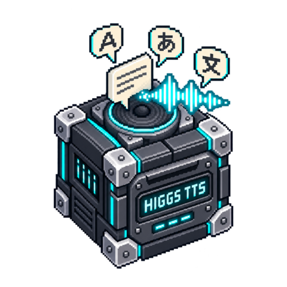

# Higgs TTS 3

[](media/cover.png)

<!-- block-metadata:start -->
[](model.json)
[](compatibility.json)
[](LICENSE)

Verified BloxSmith versions: **1.0.9** (bundled-block tests; see [test evidence](compatibility.json)).
<!-- block-metadata:end -->

This autonomous BloxSmith adapter targets the official **self-hosted SGLang-Omni**
speech interface for **Boson AI Higgs TTS 3**. The earlier model identifier
`bosonai/higgs-audio-v3-tts-4b` now resolves to `bosonai/higgs-tts-3-4b`.
The server administrator prepares and runs the model; this block does not claim
to load weights inside BloxSmith or to support Boson's distinct hosted API.

## Connect and configure

1. Prepare and start your own Higgs server separately. See the official cookbook
   below and the exact HTTP contract in `upstream_contract.json`.
2. Enter its **root URL**, without `/v1/audio/speech`. An explicit reverse-proxy
   prefix is supported. HTTPS verifies both certificates and hostnames; plain HTTP
   is allowed only for numeric loopback addresses. There are no redirects, ambient
   proxies, hidden credential discovery or hosted-provider fallbacks.
3. Optionally enter a server bearer-token **wallet reference**, not a raw key.
   A short name resolves to `secret://workspace/name`; full workspace or
   `secret://project/project-id/name` references are supported.
   An empty reference means anonymous server access. An optional CA PEM file
   selects your private trust store without disabling certificate verification.
4. Enable **server access** and connect text. Access is off by default. Merely
   adding the block, preparing a Run or pressing Play sends no synthesis request.

| Port | Contract |
| --- | --- |
| `text` input | Plain text, or JSON `{ "text": "Hello", "request_id": "turn-1" }` delivered with `application/json`. |
| `command` input | Exactly `{ "action": "interrupt" }`; not inferred from speech text. |
| `audio_file` output | Path of one complete, uniquely named WAV or Ogg/Opus file. |
| `metadata` output | Correlation, complete/finish reason, duration, format, sample rate, byte count, SHA-256 and requested model/settings. |
| `status` output | Correlated completion, interruption, queue rejection or safe recoverable error; no partial audio path. |

Plain text that looks like JSON is still spoken as text. An interrupt takes
precedence when text and command are delivered together. Cached text is not
replayed on a command event. Repeated text/request IDs are new explicit requests;
there is no durable deduplication or automatic retry after a failed response.

This is **file synthesis**, not a live `audio_stream` output. Default output is
48 kHz mono **Ogg/Opus**, encoded locally with FFmpeg; WAV preserves the server's
24 kHz mono PCM16. Empty output directory uses the node's persistent `audio/`
directory. Relative paths resolve against the application root. Filenames are
unique and atomically published; existing results are never overwritten or
automatically deleted. Files can contain private speech; retain or remove them
according to your own data policy.

## Execution and interruption

Both One Shot Simulation and Active Runtime execute actual HTTP requests when
enabled text is delivered; Simulation is not a dry run. Active Runtime maintains
one in-flight job and a bounded node-local FIFO (default four pending requests).
Zero pending capacity refuses new text while busy. Requests not admitted to this
queue receive `queue_full`; it is not a guarantee about upstream framework queues.

Interrupt closes the owned HTTP request/process, fences its file output and clears
earlier pending text. A later request can run normally. Already published files
and downstream players are unchanged: wire player interruption separately. The
official server attempts abort on client disconnection, but this block **does not
confirm remote GPU termination**. Stop and abrupt package-host death also terminate
the owned local process group. A forcibly killed host may leave a private unfinished
job directory, never exposed as a completed result.

The server must report `X-Finish-Reason: stop` and return a complete canonical PCM
WAV. `length`, an absent/unknown reason, malformed audio, truncated transfer and
oversized output are refused. The block never relabels a limited generation as
complete or truncates it into a successful result. No raw provider body, bearer
token or source text is copied into block diagnostics.

## Settings and interface

Main settings: explicit server access/root URL, wallet reference, output directory,
server voice and file format. `default` needs no reference clip; other voice names
must already be provisioned by the administrator. The block does not upload voice
references or promise multi-speaker dialogue. Text and inline Higgs control tags
are passed through; language is inferred by the model, not forced by an invented
language option.

Advanced settings include the served model alias, CA file, temperature (0.1–2),
top-k (1–500), generated-token cap (16–4096), accepted duration (1–180 seconds),
text limit (1–4000 characters and at most 8192 UTF-8 bytes), total per-job deadline
(1–240 seconds) and pending capacity (0–16). Duration is a **local acceptance
limit**, not an additional server synthesis option. Deadlines begin after dequeue
and include connection, synthesis, transfer, encoding and publication. Server
context/hardware limits still apply; there is no claim that every allowed text
fits into every token budget.

Modal and inspector offer the same English/French draft settings with associated
labels, numeric validation, keyboard tabs and responsive layout. Apply persists;
Cancel discards. Reload an already prepared Run to use new settings.

## Upstream identity and scope

- Model: `bosonai/higgs-tts-3-4b`, revision
  `239f63fb7b02b1aa085f98d9efae5e35cc5523e8` inspected for integration.
- Official SGLang-Omni source: revision
  `353cf3535f8a67a020facc80aef93eba9f8ed5bc` inspected for the HTTP contract.
- The model checkpoint is approximately 9.31 GB, with the audio codec bundled
  inside it. The dedicated serving environment and hardware are additional.
- Runtime integration addresses one explicitly configured server. No automatic
  model installation, implicit credential discovery or hosted-provider fallback.

The model card's older SSE example differs from the inspected current server's
SSE event format; raw PCM streaming is a third contract. This block uses none of
those streaming paths: it calls `POST /v1/audio/speech` with `stream: false`,
`response_format: "wav"`, and requires the binary response's terminal header.
Proxies must preserve that header. The inspected server revision is an **adapter
contract pin**, not proof of which weights a remote administrator actually loaded;
metadata therefore reports `server_revision_verified: false`.

## Tests and remaining qualification

Portable package suites exercise real local HTTP/TLS, the actual owned HTTP
process, FFmpeg/FFprobe, strict completion and WAV gates, no-retry/privacy behavior,
interruption, timeout and abrupt parent death. Runtime suites use disposable wallets
and both execution modes across bundled, managed and linked installations. Browser
suites exercise real modal/inspector surfaces, Apply/Cancel and narrow layouts.
Provider responses are **synthetic tones**. No real Higgs model inference, voice
quality, language coverage, GPU performance or live server deployment has yet been
qualified. Those checks remain necessary before claiming model readiness.

An optional helper prepares a qualification plan without connecting:

```sh
python tests/qualify_server.py --server SERVER_ROOT_URL --storage DISPOSABLE_DIRECTORY
```

Only adding `--execute` sends two short English/French example texts and saves
complete audio plus private JSON evidence. `--with-token` reads an optional token
from a hidden terminal prompt, never an argument or tracked configuration. Do not
point it at a production server without arranging the associated model rights and
capacity. The report distinguishes protocol success from listening/quality review
and does not assert the server's actual weight revision.

Linux, Python 3.10+, FFmpeg and an independently running compatible server are
required. The proprietary framework and test harness are not redistributed here.

## License

Block-owned code is Apache-2.0. The **model is not Apache-2.0**: consult the
[Boson Higgs TTS 3 license](https://huggingface.co/bosonai/higgs-tts-3-4b/blob/239f63fb7b02b1aa085f98d9efae5e35cc5523e8/LICENSE)
for research, non-commercial, creator and commercial-use conditions. Deploying this
adapter does not grant model-use rights. No weights, server implementation or
proprietary BloxSmith framework are redistributed in this package.

References: [official model](https://huggingface.co/bosonai/higgs-tts-3-4b),
[upstream migration notice](https://github.com/boson-ai/higgs-audio),
[SGLang-Omni cookbook](https://sgl-project.github.io/sglang-omni/cookbook/higgs_tts.html).
